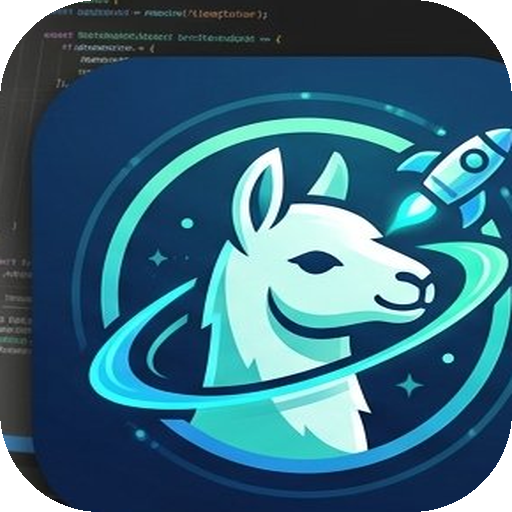
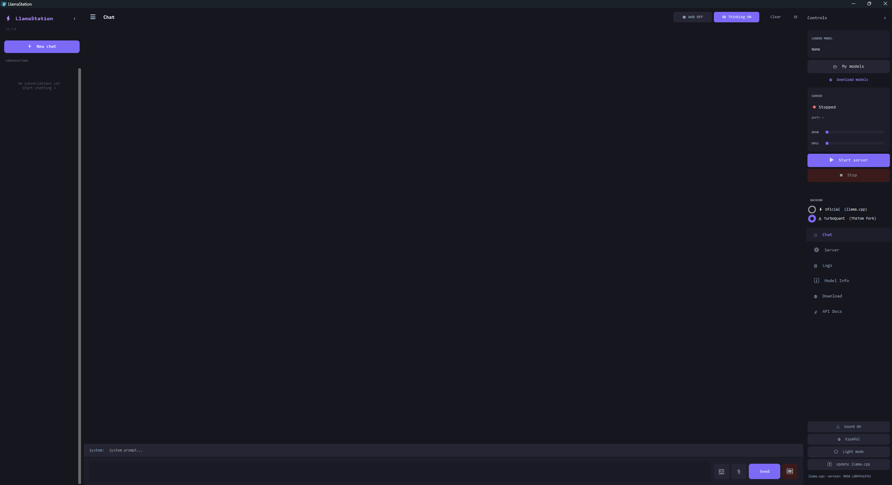
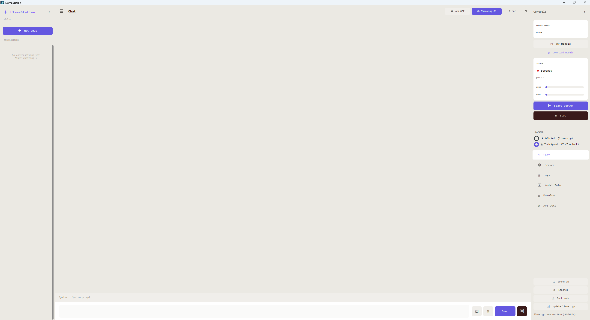
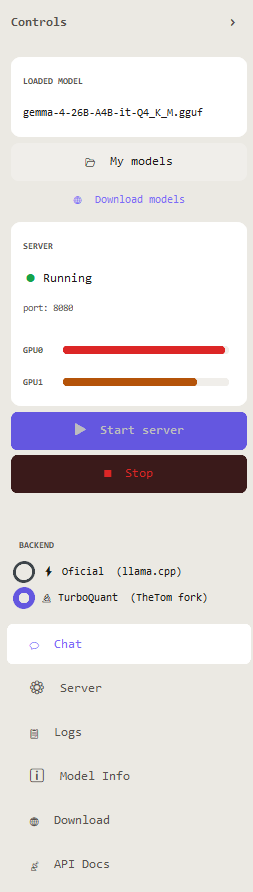
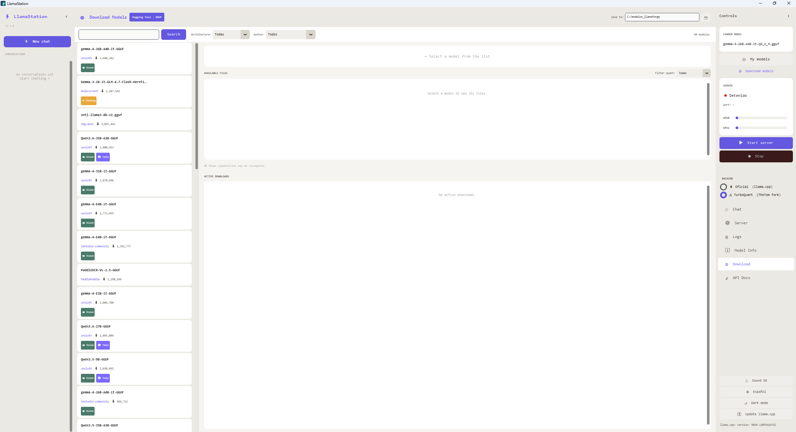
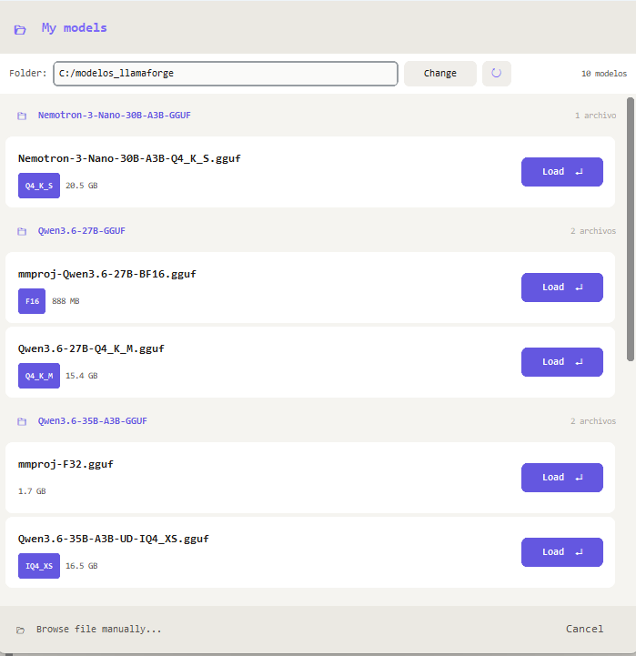

<p align="center">
  
</p>

<h1 align="center">⚡ LlamaStation</h1>
<p align="center"><b>Рабочая станция для моделей ИИ — графический интерфейс llama.cpp для Windows</b></p>

<p align="center">
  
  
  
  
  
</p>

<p align="center">
  Мощный графический интерфейс с открытым исходным кодом для запуска локальных моделей ИИ через llama.cpp — для тех, кто хочет полностью управлять своим оборудованием без лишней сложности.
</p>

> [English version](README-en.md). В этой версии русский перевод исходного кода ещё не завершён. Архив `LlamaStation.zip` содержит оригинальный EXE без перевода; переведённая сборка Windows пока не подготовлена.

---

## 🧑‍💻 Создано не программистом с помощью ИИ

Я создал это приложение, потому что не хотел запускать llama.cpp из командной строки каждый раз, когда хотелось пообщаться с локальной моделью. Хотелось чего-то простого, что просто работает.

**На 100% создано методом вайб-кодинга** — я не профессиональный разработчик. Каждая строка этого приложения написана с помощью ИИ (в основном Claude). Если вы программист и что-то вызывает у вас ужас, пожалуйста, отнеситесь с пониманием — pull request'ы очень приветствуются.

---

## Скриншоты

<table>
  <tr>
    <td><br/><sub>Тёмная тема</sub></td>
    <td><br/><sub>Светлая тема</sub></td>
  </tr>
  <tr>
    <td><br/><sub>Мониторинг видеопамяти двух GPU в реальном времени</sub></td>
    <td><br/><sub>Обзор моделей Hugging Face</sub></td>
  </tr>
</table>

<p align="center">
  <br/>
  <sub>Обзор локальных моделей с информацией о квантовании</sub>
</p>

---

## Почему LlamaStation?

Большинство интерфейсов для llama.cpp жертвуют управлением ради простоты или наоборот. LlamaStation предлагает и то и другое: понятный интерфейс с полным доступом ко всем параметрам для опытных пользователей, которые хотят максимально использовать своё оборудование.

- **Без телеметрии, учётных записей и подписок.** Всё работает локально и принадлежит вам.
- Разработана специально для **конфигураций с несколькими GPU**, с мониторингом видеопамяти каждой GPU.
- Поддерживает как **официальную llama.cpp**, так и **форк TurboQuant** (асимметричное квантование KV-кэша).
- **API, совместимый с OpenAI**, — замена для приложений, использующих OpenAI.

---

## Возможности

### 🖥️ Интерфейс
- Тёмная и светлая темы.
- Русский и английский интерфейс. В этой версии русский перевод размещён в исходном блоке `es` и пока не завершён.
- Сворачиваемые боковые панели.
- История чатов с управлением диалогами.
- **Управление режимом размышлений** — два независимых переключателя:
  - **👁 Рассуждения** — показать или скрыть блок рассуждений в чате.
  - **🧠 Think ON / ⚡ Think OFF** — полностью включить или отключить размышления модели через `chat_template_kwargs`. Действует для всех подключённых клиентов (чат, совместимый с OpenAI API, внешние агенты). При переключении сервер автоматически перезапускается. Совместимо с форком TurboQuant.
- **Поиск в интернете и Deep Research** через собственный экземпляр SearXNG (многоэтапное исследование без ключа API — см. [настройку поиска](#-настройка-поиска-в-интернете-searxng) ниже).
- Поддержка изображений — прикрепление к чату для мультимодальных моделей.
- Прикрепление файлов — отправка файлов с кодом непосредственно модели.

### 🎤 Голосовой режим
Общайтесь с локальной моделью голосом и слушайте её ответы полностью без подключения к интернету.
- Режимы **🎙 Push-to-talk** и **🔊 постоянного прослушивания**, встроенные в основной чат.
- **Клонирование голоса** через XTTS v2 — запишите 12 секунд голоса или импортируйте запись, и модель будет отвечать этим голосом.
- **Распознавание речи** с помощью faster-whisper (tiny / base / small / medium / large-v3).
- Поддерживаются 14 языков (es, en, fr, de, it, pt, pl, nl, cs, ar, zh-cn, ja, hu, ko).
- Регулируемая скорость речи (0,5×–2,0×).
- XTTS может работать на **CUDA или CPU**.
- Голосовой ответ воспроизводится **только** на голосовое сообщение — ответы на текстовые сообщения остаются текстовыми, как в голосовом режиме ChatGPT.
- Теги `<think>` и `<|channel>` автоматически удаляются перед синтезом речи, чтобы внутренние рассуждения не зачитывались вслух.
- Необязательная автоматическая загрузка голосовых моделей при запуске.
- Отдельная вкладка **«Голос»** с настройками и тестовым чатом.

### ⚙️ Управление моделями
- Загрузка любой модели `.gguf` с полным набором параметров в диалоговом окне.
- Автоматическое сохранение профиля и настроек для каждой модели.
- Автоматическое обнаружение файлов mmproj для моделей с поддержкой изображений.
- Обзор локальных моделей с обозначениями квантования.
- Загрузка моделей напрямую с Hugging Face с метками возможностей (Vision, Tools, Thinking, Code и т. д.).

### 🔧 Управление сервером
- Запуск и остановка сервера llama.cpp одним нажатием.
- **Мониторинг видеопамяти каждой GPU в реальном времени** с цветовой индикацией (зелёный, жёлтый, красный).
- Поддержка нескольких GPU: распределение по слоям или строкам и соотношение распределения тензоров.
- Непрерывная пакетная обработка, Flash Attention и перенос KV-кэша на GPU.
- Асимметричный KV-кэш (разные типы для K и V — TurboQuant).
- Автоматическое обновление llama.cpp с GitHub.
- **🛡️ Мониторинг сервера** — обнаружение неожиданных сбоев (например, нехватки памяти) и необязательный автоматический перезапуск через 5 секунд. Настраивается переключателем на вкладке «Сервер».
- **🧹 Очистка резервных копий** — при каждом обновлении llama.cpp создаётся копия предыдущей установки. На вкладке «Сервер» можно посмотреть общий размер копий и удалить их все сразу.

### 📡 API и режим без интерфейса
- Встроенная вкладка документации API с готовыми примерами curl и Python.
- **Режим без графического интерфейса** использует сохранённые профили моделей:

```bash
# Interactive model selector
python llamastation.py --no-gui

# Direct launch
python llamastation.py --no-gui --model C:\models\qwen3.gguf --port 8080
```

Первая команда открывает интерактивный выбор модели, вторая запускает указанную модель напрямую.

---

## Требования

- Windows 10/11.
- Python 3.11+.
- [llama.cpp](https://github.com/ggerganov/llama.cpp), собранная для вашего оборудования (CUDA, Vulkan, CPU).
- Рекомендуется GPU NVIDIA (также поддерживаются AMD/Intel через Vulkan).

```bash
pip install customtkinter requests Pillow
```

**Необязательно — для голосового режима:**

```bash
pip install coqui-tts faster-whisper sounddevice soundfile scipy pydub
```

> **Что загружается:** при первом нажатии **«Загрузить модели»** на вкладке «Голос» XTTS v2 (~1,8 ГБ) и выбранная модель Whisper (tiny ~75 МБ / base ~145 МБ / small ~465 МБ) автоматически загружаются в кэш Hugging Face. Это происходит только один раз.

**Для ускорения XTTS с помощью CUDA** (рекомендуется для GPU NVIDIA — синтез речи будет значительно быстрее):

```bash
# Requires torch 2.1.x with cuDNN 8 — do NOT use a newer torch version
pip install torch==2.1.2 torchvision==0.16.2 torchaudio==2.1.2 --index-url https://download.pytorch.org/whl/cu121
```

Требуется torch 2.1.x с cuDNN 8 — не используйте более новую версию torch.

> **⚠️ Исправление CUDA в Windows — `cudnn64_8.dll not found`:** если XTTS завершает работу при загрузке из-за ошибки cuDNN, установите пакет cuDNN:
> ```bash
> pip install nvidia-cudnn-cu11
> ```
> LlamaStation автоматически добавит его в путь поиска DLL — вручную изменять PATH не нужно.

Распознавание речи (faster-whisper) всегда работает на **CPU**, чтобы не конкурировать с GPU во время инференса LLM. XTTS может работать на CPU или CUDA; устройство выбирается на вкладке «Голос».

---

## Установка

**Вариант A — готовый EXE *(если вы просто хотите запустить приложение)***

Python и командная строка не требуются. Достаточно скачать и запустить приложение.

> Готовый EXE в текущем `LlamaStation.zip` — оригинальная сборка и не включает изменения русского перевода из исходников.

1. Откройте страницу [Releases](../../releases) и скачайте последнюю версию `LlamaStation-vX.X.zip`.
2. **Распакуйте всю папку** в постоянное место (например, `C:\LlamaStation\`) — одного файла `.exe` недостаточно.
3. Откройте распакованную папку и дважды нажмите **`LlamaStation.exe`**.
4. При первом запуске нажмите **⬆ Update / Download backend** на боковой панели — llama.cpp будет загружена и установлена автоматически. Это нужно сделать только один раз.
5. Нажмите **Download models**, найдите и скачайте модель — после этого можно общаться.

> ⚠️ При первом запуске **Windows SmartScreen** может показать предупреждение — это обычная ситуация для неподписанного приложения. Нажмите **«Подробнее»** → **«Выполнить в любом случае»**. Весь исходный код доступен для проверки на GitHub. Для дополнительной уверенности можно [проверить EXE через VirusTotal](https://www.virustotal.com) перед запуском.

> 💡 **Голосовой режим не входит** в выпуск `.exe`: ему нужны PyTorch и XTTS (около 3 ГБ зависимостей). Для голосового режима используйте вариант B.

---

**Вариант B — запуск из исходного кода**

1. Скачайте репозиторий: нажмите зелёную кнопку **Code** → **Download ZIP** и распакуйте архив в удобное место.
   *(Или выполните `git clone https://github.com/game19m-a11y/llamastation-ru`, если знакомы с git.)*
2. Откройте распакованную папку и дважды нажмите **`iniciar_llamastation.bat`**.
3. При первом запуске зависимости установятся автоматически — это займёт несколько минут.
4. После завершения LlamaStation запустится автоматически.
5. При следующих запусках достаточно дважды нажать тот же файл `.bat`.

> ⚠️ **Требуется Python 3.11.** Если `.bat` сообщает, что Python не найден, сначала скачайте и установите его с [python.org](https://www.python.org/downloads/).

> ⏳ **Первый запуск занимает время:** `.bat` устанавливает все зависимости, включая голосовой режим (XTTS v2, Whisper, torch). Это происходит один раз и может занять 5–10 минут в зависимости от соединения. Последующие запуски происходят сразу.

---

## Быстрый старт

1. Запустите LlamaStation.
2. Нажмите **⬆ Обновить / скачать бэкенд** внизу левой боковой панели — движок инференса будет загружен и установлен автоматически. Это нужно сделать один раз.
3. Нажмите **Скачать модели** → найдите модель (например, `gemma-4`) → скачайте её.
4. Нажмите **Мои модели** → выберите файл `.gguf` → настройте и загрузите модель.
5. Нажмите **▶ Запустить сервер** — индикаторы видеопамяти будут заполняться при загрузке модели.
6. Начните общение.

---

## Настройка нескольких GPU (2× RTX 3060 и т. д.)

LlamaStation поддерживает работу с несколькими GPU. В окне загрузки модели:

- **Split Mode**: `layer` (рекомендуется) распределяет слои модели между GPU.
- **Tensor Split**: задайте соотношение, например `1,1` для 50/50 или `3,1` для 75/25.
- Следите за **индикатором видеопамяти** в реальном времени, чтобы проверить распределение.

---

## 🔍 Настройка поиска в интернете (SearXNG)

Режимы **поиска в интернете** и **🔬 Deep Research** используют собственный экземпляр [SearXNG](https://github.com/searxng/searxng) вместо стороннего API. Это сохраняет локальность и приватность поиска и позволяет обходиться без API-ключей и ограничений частоты запросов. Для работы необходим запущенный контейнер SearXNG с **включённым выводом JSON**.

### 1. Запустите SearXNG в Docker

```bash
docker run -d \
  --name searxng \
  -p 8888:8080 \
  -v "${PWD}/searxng:/etc/searxng" \
  --restart unless-stopped \
  searxng/searxng:latest
```

Или используйте `docker-compose`:

```yaml
services:
  searxng:
    image: searxng/searxng:latest
    container_name: searxng
    ports:
      - "8888:8080"
    volumes:
      - ./searxng:/etc/searxng
    environment:
      - SEARXNG_BASE_URL=http://localhost:8888/
    restart: unless-stopped
```

### 2. Включите формат JSON

По умолчанию SearXNG отдаёт только HTML. LlamaStation нужен JSON API, поэтому откройте созданный после первого запуска файл `searxng/settings.yml` и убедитесь, что `json` указан в `search.formats`:

```yaml
search:
  formats:
    - html
    - json
```

После сохранения перезапустите контейнер:

```bash
docker restart searxng
```

### 3. Укажите экземпляр SearXNG в LlamaStation

На вкладке **«Сервер»** установите в поле **SearXNG URL** значение `http://localhost:8888` (по умолчанию). Если SearXNG работает на другом компьютере или порту, измените URL соответствующим образом. После этого переключатель **🔬 Deep** и кнопка обычного поиска в чате будут использовать его автоматически.

> 💡 Deep Research выполняет несколько раундов запросов к SearXNG, уточняя поиск по предыдущим результатам, прежде чем составить итог. Поэтому он заметно медленнее одиночного поиска.

### 4. Интеграция с ботом Telegram

Мост Telegram (`llamastation_telegram.py`) использует тот же экземпляр SearXNG для поиска в чатах, поэтому отдельная настройка не нужна — убедитесь лишь, что SearXNG запущен до старта бота.

- Укажите тот же `SEARXNG_URL` (по умолчанию `http://localhost:8888`) в конфигурации бота, чтобы он мог подключиться к контейнеру.
- Поиск запускается автоматически, когда модель решает, что запросу нужна актуальная информация, или вручную через команду поиска бота.
- Если SearXNG недоступен, бот переключается на DuckDuckGo: поиск продолжит работать, но без возможностей SearXNG, таких как обработка JSON и многоэтапное исследование.
- Запускайте бота на том же хосте или в той же сети, что и контейнер SearXNG, либо убедитесь, что порт доступен. В сетях Docker используйте имя контейнера (например, `http://searxng:8080`) вместо `localhost`.

---

## Поддерживаемые бэкенды

| Бэкенд | Описание |
|---|---|
| ⚡ Официальный llama.cpp | Стандартная сборка — CUDA, Vulkan, CPU. Нативно поддерживает **MTP** с мая 2026 года |
| 🔬 TurboQuant (форк TheTom) | Асимметричное квантование KV-кэша — контекст более 200 тыс. токенов на 24 ГБ видеопамяти |
| ⚛️ AtomicChat (TurboQuant + MTP) | Сочетание TurboQuant и MTP — около 22 токенов/с на двух RTX 3060 с контекстом 177 тыс. токенов |
| 🐝 BeeLlama (DFlash + TurboQuant) | Спекулятивное декодирование DFlash с TurboQuant — экспериментально |

**Добавить свой форк** можно двумя строками кода: измените словарь `BACKENDS` в `llamastation.py`, указав путь к вашему `llama-server.exe`. Подходит любой форк, собираемый из llama.cpp.

```python
BACKENDS = {
    "⚡ Official  (llama.cpp)":      r"C:\llama.cpp\llama-server.exe",
    "🔬 TurboQuant  (TheTom fork)":  r"C:\llama-turboquant\llama-server.exe",
    "🧪 My Custom Fork":             r"C:\llama-myfork\llama-server.exe",  # ← add yours
}
```

---

## Использование API

LlamaStation предоставляет совместимый с OpenAI API по адресу `http://localhost:8080/v1`. Любое приложение с поддержкой OpenAI может работать с ним без дополнительной настройки:

```python
from openai import OpenAI

client = OpenAI(base_url="http://localhost:8080/v1", api_key="no-key")
response = client.chat.completions.create(
    model="local",
    messages=[{"role": "user", "content": "Hello!"}]
)
print(response.choices[0].message.content)
```

Другие примеры приведены на вкладке **документации API** в приложении.

---

## Структура файлов

```
llamastation/
├── llamastation.py              # Main application
├── llamastation_downloader.py  # HuggingFace model downloader
├── llamastation_voice.py       # Voice mode (Whisper + XTTS v2)
├── llamastation_i18n.py        # Translations (ES/EN)
├── llamastation_icon.ico     # App icon
├── iniciar_llamastation.bat  # Windows launcher
├── llamastation_profiles.json  # Per-model settings (auto-generated)
└── llamastation_settings.json  # App settings (auto-generated)
```

Основное приложение находится в `llamastation.py`; рядом расположены загрузчик моделей, голосовой модуль, переводы, значок и файл запуска для Windows. Файлы профилей и настроек создаются автоматически.

---

## Добавление языка

Откройте `llamastation_i18n.py`, скопируйте блок `"en"`, переименуйте его в код нужного языка (например, `"fr"`), переведите значения и откройте pull request. Согласно документации исходного проекта, другие файлы менять не нужно.

---

## Участие в разработке

Pull request'ы приветствуются. Код намеренно размещён в небольшом количестве файлов, чтобы его было проще понимать и изменять. При добавлении возможностей обновляйте блоки `"es"` и `"en"` в `llamastation_i18n.py`; в этом репозитории блок `"es"` содержит русский перевод.

---

## Авторы и лицензии сторонних компонентов

LlamaStation — графический интерфейс. Сам инференс обеспечивается следующими проектами с открытым исходным кодом:

| Проект | Автор | Лицензия | Назначение |
|---|---|---|---|
| [llama.cpp](https://github.com/ggml-org/llama.cpp) | Georgi Gerganov / ggml-org | MIT | Основной движок инференса LLM (официальный бэкенд) |
| [llama-cpp-turboquant](https://github.com/TheTom/llama-cpp-turboquant) | TheTom | MIT | Форк llama.cpp со сжатием KV-кэша TurboQuant (turbo2/3/4) |
| [atomic-llama-cpp-turboquant](https://github.com/AtomicBot-ai/atomic-llama-cpp-turboquant) | AtomicBot-ai | MIT | Форк llama.cpp с TurboQuant и MTP |
| [coqui-tts (XTTS v2)](https://github.com/coqui-ai/TTS) | Coqui | CPML | Клонирование голоса и синтез речи на вкладке «Голос» |
| [faster-whisper](https://github.com/SYSTRAN/faster-whisper) | SYSTRAN | MIT | Быстрое распознавание речи с помощью CTranslate2 |

TurboQuant основан на статье [TurboQuant (arXiv:2504.19874, ICLR 2026)](https://arxiv.org/abs/2504.19874) Zirlin и соавторов.

Оба бэкенда распространяются по лицензии MIT — `Copyright © 2023-2026 The ggml authors`. Полный текст лицензии находится на вкладке **⚖️ О программе** внутри приложения.

---

## Лицензия

MIT — используйте как хотите.

---

<p align="center">
  Сделано с ❤️ для сообщества локального ИИ<br/>
  <sub>Не связано ни с одной компанией, работающей в области ИИ</sub>
</p>
